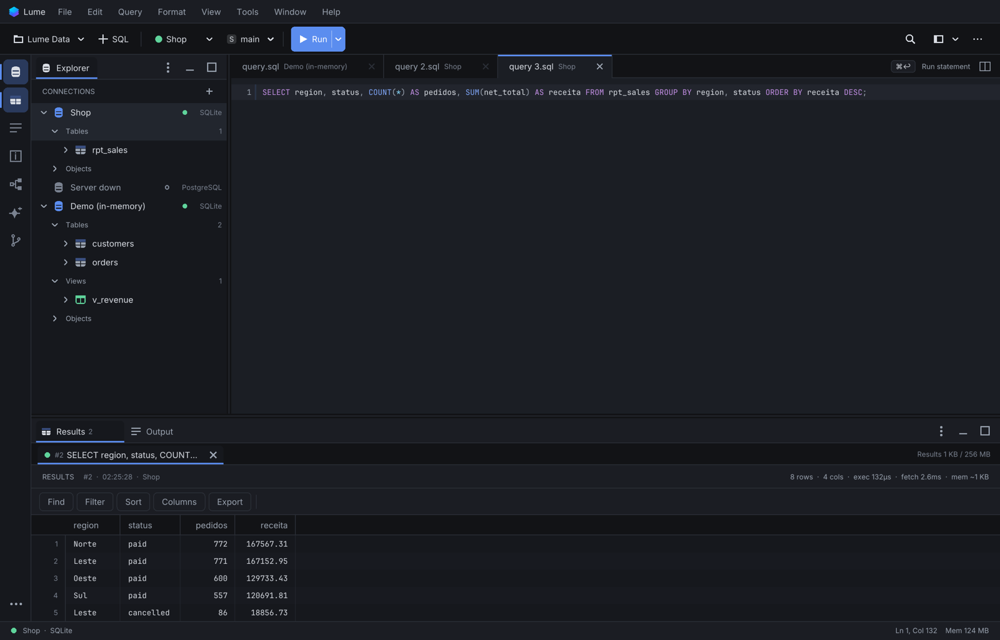
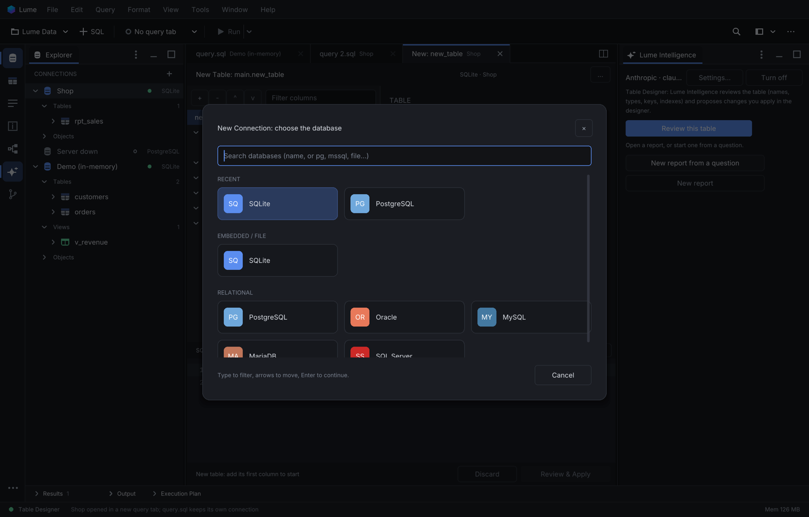
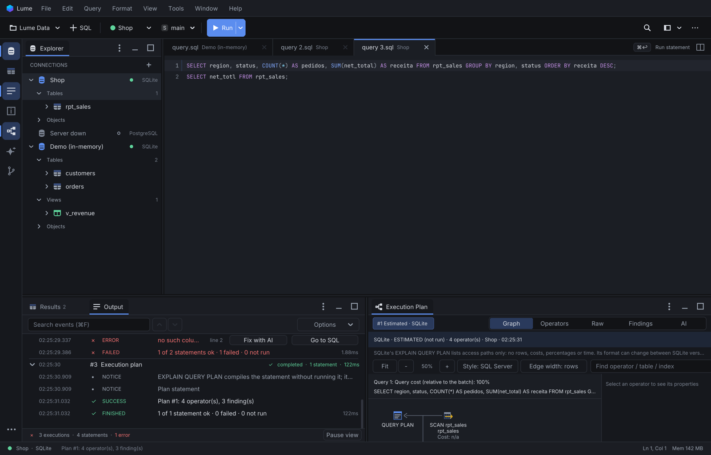
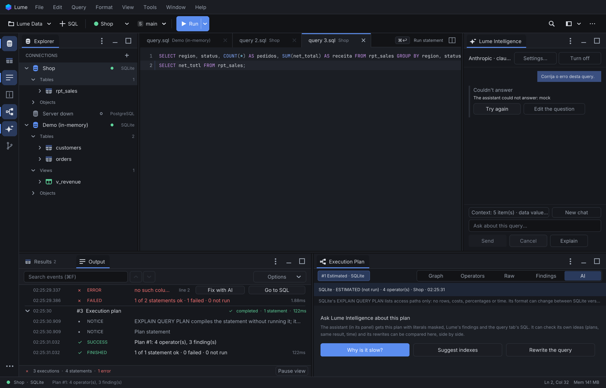
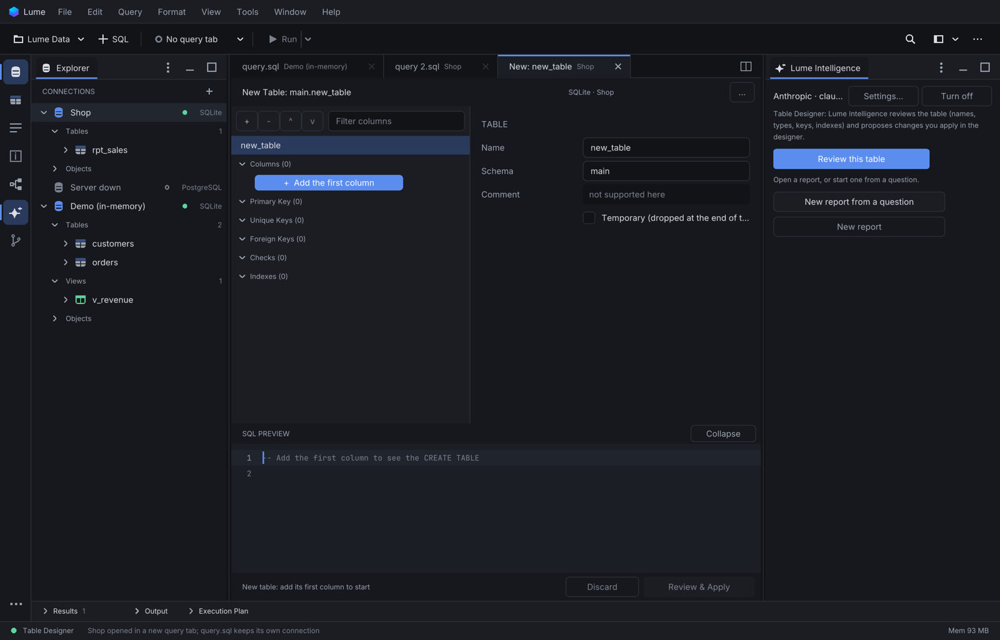
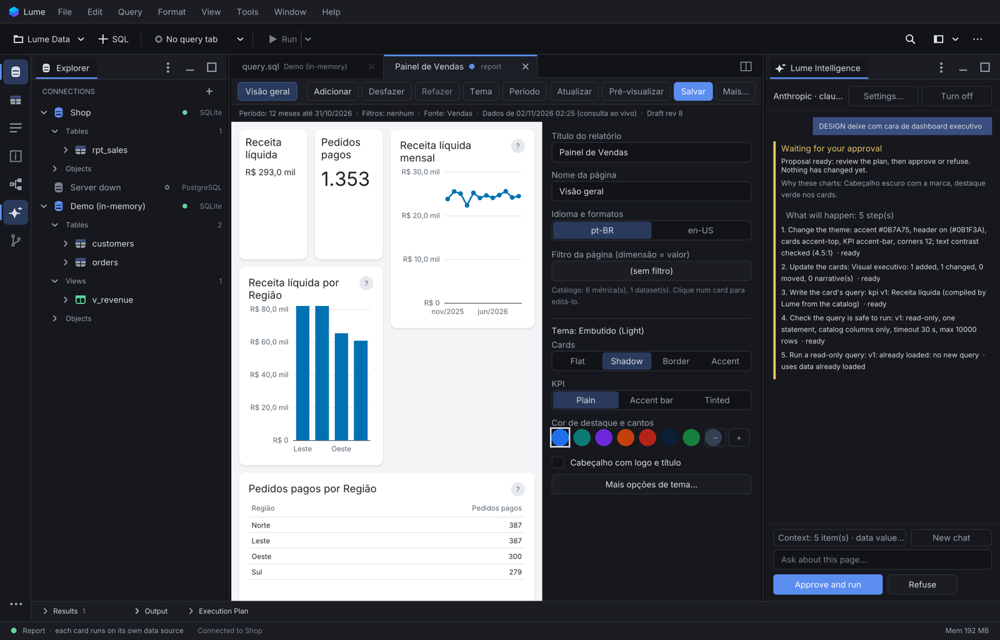

# Lume Data

A native database IDE written in C. One window for writing SQL, reading results, understanding
execution plans, designing tables, building reports, and asking an AI assistant for help, without
Electron and without a runtime.



- **Native and light.** About 2.3 MB of binary, drawn on the GPU through SDL3 (Metal, Vulkan,
  Direct3D), HiDPI aware, idle at ~0% CPU (the loop sleeps until something happens).
- **Six databases.** SQLite built in; PostgreSQL, Oracle, MySQL, MariaDB and SQL Server through the
  client libraries already installed on the machine, loaded at run time.
- **AI that asks first.** Lume Intelligence is off until you turn it on. The structure of a database
  is shared only after you allow it, rows only with a separate consent, and nothing it writes runs
  without your approval.
- **Cross-platform.** macOS (universal DMG, signed with a Developer ID), Linux (x86_64, arm64), and
  Windows (in progress).

## Motivation

> _Draft: to be written by the author._

Day-to-day database work tends to be spread over heavy tools: one for queries, another for
execution plans, another for reports, a browser tab for an AI chat that knows nothing about the
database in front of you. Lume Data puts that work in one small native program that opens
instantly, stays out of the way, and keeps the user in control of what leaves the machine.

## What it does

### Connections and schema
- A database picker with search (`pg`, `mssql`, `file`...), grouped by kind, then a form with the
  fields of that driver. **Test connection** runs in the background and reports the server's answer.
- Environments (DEV / HML / PROD) and a **Read-only in Lume** switch; choosing PROD suggests it.
- Passwords and AI keys live in the operating system's secret store (macOS Keychain, Windows
  Credential Manager, Secret Service on Linux).
- Schema explorer built for large catalogs (tested with 170,000 schemas and 36,000 tables): names
  first, details on demand, server-side search, pinned schemas.



### SQL editor and results
- Query tabs bound to a connection, syntax highlighting, autocomplete from the cached schema
  (aliases, `JOIN` targets, ranking by your own usage), run the statement under the cursor
  (`⌘↩` / `Ctrl+Enter`) or the whole script, with a real cancel that reaches the server.
- Results belong to the tab that ran them: run again and they are replaced; switch tabs and you see
  that tab's last run.
- A result grid with real cursors (fetch more / fetch all, never an invented total), virtual rows
  and columns, multi-column sort, filters, search, aggregates of the selection, a JSON tree viewer,
  binary / image / geometry previews, charts, transpose and compare.
- Edit table previews with a primary key: changes stay pending until **Review and apply** shows the
  SQL and runs it in one transaction, with optimistic checks against concurrent changes.
- Export to CSV, TSV, JSON, Markdown, SQL `INSERT` and XLSX, streamed through the open cursor.
- Execution Output: every run as structured events (start, rows, notices, errors with SQLSTATE and
  position, transaction state), with **Fix with AI** and **Go to SQL** next to an error.

### Execution plans
- Estimated and actual plans for SQLite, PostgreSQL, Oracle, MySQL, MariaDB and SQL Server, as a
  graph, an operator table and the raw output.
- Findings with their evidence (full scans, misestimates, spills, missing indexes), plan comparison,
  and hypothetical indexes on PostgreSQL (with `hypopg`, nothing is created).



### Lume Intelligence
- One assistant beside every tab. In a query tab it writes, fixes, explains and rewrites SQL in the
  database's dialect, using only tables and columns that exist.
- It reads the execution plan you have open, proposes a rewrite or an index, and can **check its own
  hypothesis**: compare the estimated plans, test a hypothetical index, or run both queries
  read-only (after your approval) and compare row counts and a checksum. No row is sent to the
  model for that.
- For large databases a local index of the catalog picks the tables that matter for each question;
  the model can ask to search or describe more.
- Every proposal is a preview: **Apply to editor** is one undo step, and statements that change data
  are flagged.
- Providers: Anthropic, OpenAI, a ChatGPT plan, or a local OpenAI-compatible model.



### Database objects and table design
- Object editor for views, functions, procedures, triggers and packages, with drafts, a diff
  against the server, a reviewed apply and the status the server reports back (`VALID` /
  `INVALID` with its errors).
- Visual Table Designer for PostgreSQL, MySQL, MariaDB, SQL Server, Oracle and SQLite: columns,
  keys, indexes and checks, the exact DDL before anything runs, a risk level for each change, and
  drift detection when the table changed on the server meanwhile.



### Report Studio
- Reports made of KPI, line, bar, table and text cards over a semantic catalog or the card's own
  SQL, with report-wide filters and periods.
- Themes (colors, header with logo, card styles), pages, and an AI design pass that proposes a
  layout you approve step by step.
- Export to HTML, PDF, PNG, CSV and XLSX.



### Around the editor
- Source Control: Git status, staging by hunk, commit, pull strategies, push, with an optional AI
  review of the staged change.
- Command palette (`⇧⌘P`), dockable panels with saved layouts, Settings (`⌘,`), keyboard first.

## Install

Release builds come from the GitHub Actions workflow **Release builds** (run by hand):

| Platform | Package |
|---|---|
| macOS 11+ (Apple Silicon and Intel) | `Lume-Data-<version>-macos-universal.dmg` |
| Linux x86_64 / arm64 | `lume-data-<version>-linux-<arch>.tar.gz` (portable; run `./lume`) |
| Windows x64 | `lume-data-<version>-windows-x64.zip` (experimental) |

The database client libraries are not bundled: install the ones you need (for example `libpq`
for PostgreSQL, Oracle Instant Client for Oracle) and Lume Data finds them at run time.

## Build from source

Requires CMake 3.20+, a C11 compiler, SDL3 and SQLite.

```sh
# macOS
brew install sdl3 cmake
cmake -S . -B build -DCMAKE_BUILD_TYPE=Release
cmake --build build
./build/lume [database.db]
```

On Linux install the SDL3 and SQLite development packages (or build SDL3 from source); on Windows
use vcpkg (`sdl3`, `sqlite3`) with its CMake toolchain file.

## Tests

- `sh tests/run_all.sh` runs the full suite (58 suites: headless checks, sanitizer runs and UI
  scenarios driven through the event harness) and writes `build/test-report.md`. The database
  suites need the PostgreSQL, Oracle, SQL Server and MySQL test containers.
- `sh tests/run_ci.sh` runs the suites that need no database server; this is what CI runs.
- The AI suites only talk to local mock servers; a run under the harness refuses any non-local AI
  endpoint.

`LUME_SCRIPT=<file> ./build/lume` replays clicks, keys and typing and saves screenshots;
`LUME_PREF_DIR=<dir>` keeps a run away from your real connections.

## License

Copyright (C) 2026 Isabella Tessarotto. Lume Data is free software under the GNU Affero General
Public License, version 3 only (`AGPL-3.0-only`); see [`LICENSE`](LICENSE).
[`LICENSING.md`](LICENSING.md) adds a section 7 permission for database client libraries loaded
from the user's installation and a note on the Lume Data name and logo. Third-party components and
their licenses are listed in `assets/licenses/THIRD_PARTY.txt`.
